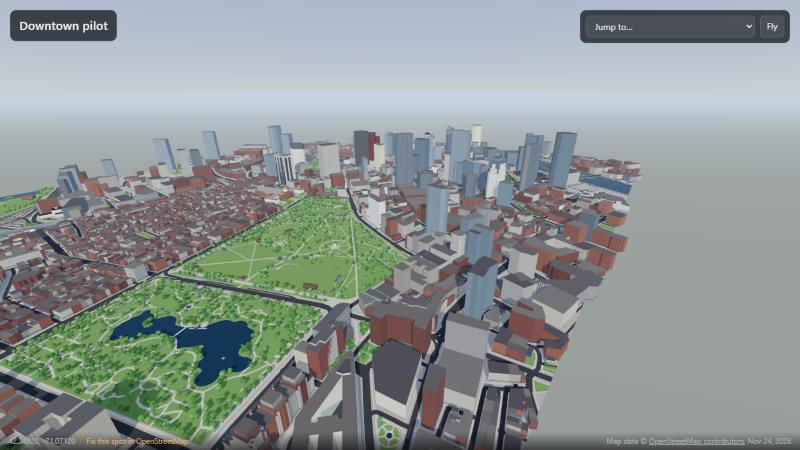
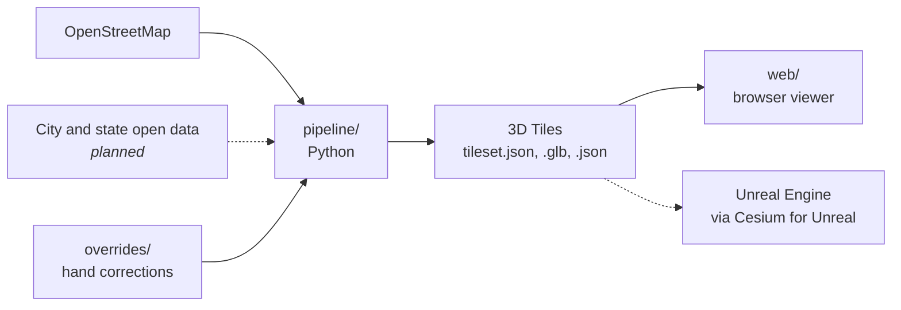

# Boston Model

An open, walkable 3D model of Boston, built from open data.



| | |
|---|---|
|  |  |

The goal is a city you can walk through that is true to the real one, and that
later carries realistic activity: trains, cars, traffic lights, shops. The model
is generated from public data by a script, so anyone can rebuild it, correct it
and add detail.

## Status

Early. One pilot district is built: about 4.6 km² of downtown covering Boston
Common, the Public Garden, Beacon Hill, Downtown Crossing, Government Center,
the Financial District and the waterfront.

What works today:

- Real building footprints, streets with curbs, footpaths, parks, water and
  mapped trees, all from OpenStreetMap.
- Walking in a browser with collision against buildings and curbs, plus a fly
  mode for an overview.
- The street you are on and the nearest named place, read from a data layer
  that ships alongside the geometry.
- Output as standard [3D Tiles](https://www.ogc.org/standards/3dtiles/), so the
  same files are meant to load in Unreal Engine through Cesium for Unreal. That
  path is documented in [docs/UNREAL.md](docs/UNREAL.md) but has not been run yet.

What is not accurate yet:

- The ground is flat. Beacon Hill is not.
- Building heights are measured for only 17% of buildings. Another 34% are
  estimated from storey counts and 48% are a default guess by building type.
- Roofs are flat and facades are a generic window grid.
- Street widths are estimated from lane counts.
- Bridges and elevated roads are drawn at ground level, and tunnels are left out.

[docs/ROADMAP.md](docs/ROADMAP.md) lists what closes each of these gaps.

## Run it

You need Python 3.11 or newer and Node.js 22 or newer.

```sh
# 1. Build the tiles (about a minute, mostly the download)
python -m venv .venv
.venv\Scripts\activate            # Windows; on macOS or Linux: source .venv/bin/activate
pip install -e "./pipeline[dev]"
boston-pipeline fetch pilot       # downloads about 11 MB of OpenStreetMap data
boston-pipeline build pilot       # writes web/public/tiles

# 2. Walk around
cd web
npm install
npm run dev                       # then open http://localhost:5173
```

Controls: `W A S D` to walk, mouse to look, `Shift` to run, `Space` to jump,
`F` to fly, `1` to `9` to jump to landmarks. The address bar tracks where you
are standing, so a copied link drops someone else at the same spot.

## How it works



The repository holds no 3D scene. It holds the recipe: a pipeline that turns
source data plus a small set of hand-written corrections into tiles. Clients
only read tiles. That split is what lets a browser and a game engine show the
same city, and what lets many people contribute without merging binary files.

| Folder | What is in it |
|---|---|
| [`pipeline/`](pipeline) | Python package that downloads source data and builds tiles |
| [`web/`](web) | Browser viewer (TypeScript, three.js) |
| [`overrides/`](overrides) | Hand-written corrections applied on top of source data |
| [`areas.toml`](areas.toml) | The areas that can be built, and their landmarks |
| [`docs/`](docs) | Architecture, data sources, roadmap, Unreal guide |

[docs/ARCHITECTURE.md](docs/ARCHITECTURE.md) has the coordinate system, the
tile format and the reasoning behind them.

## Contributing

The most valuable contribution needs no code: add a missing building height or
shop to OpenStreetMap, and it appears here on the next build. The viewer has a
"Fix this spot in OpenStreetMap" link for exactly that. See
[CONTRIBUTING.md](CONTRIBUTING.md) for the other ways to help.

## Licence

Code is under the [MIT licence](LICENSE).

Built tiles contain OpenStreetMap data, © OpenStreetMap contributors, and are
distributed under the [Open Database License 1.0](https://opendatacommons.org/licenses/odbl/1-0/).
Anything that displays the model must show that credit, as the viewer does.
[docs/DATA_SOURCES.md](docs/DATA_SOURCES.md) lists every source and its terms.
