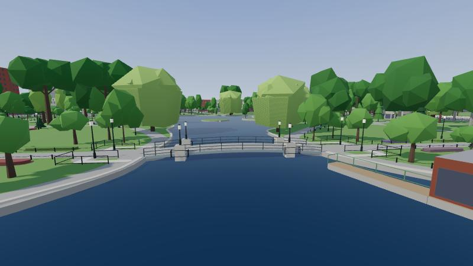
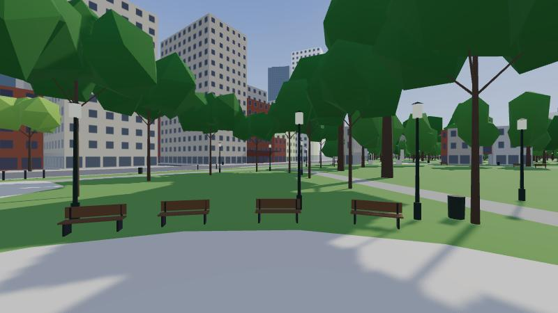
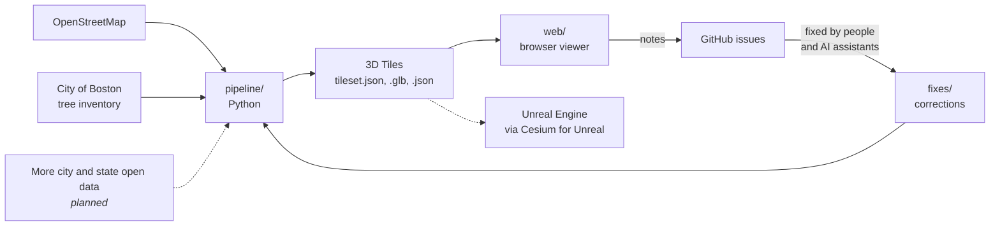

# Boston Model

An open, walkable 3D model of Boston, built from open data.

**[Walk it in your browser](https://ohinai.github.io/boston-model/)** (needs a
keyboard and mouse; about 25 MB to load).


| | |
|---|---|
|  |  |
|  |  |

The goal is a city that feels real to walk through, and that later carries
realistic activity: trains, cars, traffic lights, shops. The model is generated
from public data plus corrections kept in this repository, so anyone can
rebuild it, fix what is wrong and add detail.

See something wrong while walking? Press **N** and leave a note. It records
exactly where you stood and what you were looking at, and becomes a ticket
here.

## Status

Early. Two areas can be built. The pilot is about 4.6 km² of downtown covering
Boston Common, the Public Garden, Beacon Hill, Downtown Crossing, Government
Center, the Financial District and the waterfront. The published area, `boston`,
adds Back Bay, Kenmore, Fenway, the Longwood edge and North Brookline out to
Coolidge Corner, Washington Square and the Brookline Reservoir: about 32 km², 495 tiles.

What works today:

- Real building footprints, streets with curbs, footpaths, parks and water
  from OpenStreetMap.
- About 5,800 trees, mostly from the City of Boston tree inventory, drawn by
  species and trunk size.
- Park detail: paths in the colour of their surface, lawns, planted beds,
  benches, lamp posts, litter bins, drinking fountains, and statues, memorials
  and fountains as placeholders of the right kind and size. Pitches and courts
  have their lines, nets, hoops, goals and diamonds; playgrounds have equipment,
  and allotments their plots. Fenway Park has raked stands, the Green Monster,
  foul poles and light towers.
- Footbridges over water drawn as raised decks with railings.
- Fences, walls, retaining walls, hedges, post-and-chain fences, guard rails,
  kerbs and bollards, opened where paths cross them. The Public Garden lagoon
  has its stone edge, and willows are drawn weeping.
- Walking in a browser with collision against buildings and curbs, plus a fly
  mode for an overview. Far away the viewer draws simplified buildings, so the
  skyline is visible for kilometres.
- The street you are on, the park you are in and the nearest named place, read
  from a data layer that ships alongside the geometry.
- Notes: press `N` anywhere to report something, with your exact position
  and what you were looking at attached. Open tickets appear in the model as markers.
- Fixes as text files in [`fixes/`](fixes), and a `boston-pipeline inspect`
  command that shows what the data holds at any spot.
- A `boston-pipeline audit` command that draws the model on aerial photographs
  and proposes missing trees, so an area can be checked without walking it.
- A `boston-pipeline ground` command that sets openly licensed photographs of a
  park beside the model's view from the same spots, at eye level.
- Output as standard [3D Tiles](https://www.ogc.org/standards/3dtiles/), so the
  same files are meant to load in Unreal Engine through Cesium for Unreal. That
  path is documented in [docs/UNREAL.md](docs/UNREAL.md) but has not been run yet.

What is not accurate yet:

- The ground is flat. Beacon Hill is not.
- Building heights are measured for only 17% of buildings in the pilot. Another
  34% are estimated from storey counts and 48% are a default guess by building
  type. Across the whole `boston` area 52% are a guess.
- Brookline's trees and many of its building heights come from the Town of
  Brookline's public layers, which state no licence; they are used on the project
  owner's judgement (see docs/DATA_SOURCES.md). Brookline's trunk sizes and
  heights are less checked than Boston's.
- Roofs are flat, and facades are drawn by rule from wall colour and storeys,
  not from each building's real face.
- Street widths are estimated from lane counts.
- Tree heights and crown widths are estimates from species and trunk size, not
  measurements. You can walk under crowns, but trunks are solid.
- Statues and fountains are placeholders, not likenesses. Lamp posts are not
  drawn in their real styles. Gates are drawn open, as plain placeholders.
- Road bridges, bridges over roads and rail, and elevated roads are drawn at
  ground level, and tunnels are left out.

[docs/ROADMAP.md](docs/ROADMAP.md) lists what closes each of these gaps. Parks
and gardens come first.

## Run it

You need Python 3.11 or newer and Node.js 22 or newer.

```sh
# 1. Build the tiles (about a minute, mostly the download)
python -m venv .venv
.venv\Scripts\activate            # Windows; on macOS or Linux: source .venv/bin/activate
pip install -e "./pipeline[dev]"
boston-pipeline fetch pilot       # downloads about 13 MB: OpenStreetMap and the city tree inventory
boston-pipeline build pilot       # writes web/public/tiles
# or the whole published area, Back Bay to Coolidge Corner (about 45 MB of map data, fetched in strips)
boston-pipeline fetch boston
boston-pipeline build boston      # 495 tiles, a few minutes

# 2. Walk around
cd web
npm install
npm run dev                       # then open http://localhost:5173
```

Controls: `W A S D` to walk, mouse to look, `Shift` to run, `Space` to jump,
`F` to fly, `1` to `9` to jump to landmarks, `N` to leave a note. The address
bar tracks where you are standing, so a copied link drops someone else at the
same spot.

## How it works



The repository holds no 3D scene. It holds the recipe: a pipeline that turns
source data plus the corrections in `fixes/` into tiles. Clients
only read tiles. That split is what lets a browser and a game engine show the
same city, and what lets many people contribute without merging binary files.

| Folder | What is in it |
|---|---|
| [`pipeline/`](pipeline) | Python package that downloads source data and builds tiles |
| [`web/`](web) | Browser viewer (TypeScript, three.js) |
| [`fixes/`](fixes) | Corrections applied on top of source data |
| [`AGENTS.md`](AGENTS.md) | Guide for AI coding assistants fixing notes |
| [`areas.toml`](areas.toml) | The areas that can be built, and their landmarks |
| [`docs/`](docs) | Architecture, data sources, roadmap, Unreal guide |

[docs/ARCHITECTURE.md](docs/ARCHITECTURE.md) has the coordinate system, the
tile format and the reasoning behind them.

## Contributing

The simplest contribution needs no setup: walk the model, press `N` where
something looks wrong, and file the ticket. Fixing a ticket means adding a
small text file under `fixes/`, which is set up to be done with an AI coding
assistant. You can also check an area against aerial photographs with
`boston-pipeline audit`. All fixes go through this repository. See
[CONTRIBUTING.md](CONTRIBUTING.md).

## Licence

Code is under the [MIT licence](LICENSE).

Built tiles contain OpenStreetMap data, © OpenStreetMap contributors, and are
distributed under the [Open Database License 1.0](https://opendatacommons.org/licenses/odbl/1-0/),
as are the files in `fixes/`.
Tree positions and species also come from the City of Boston tree inventory,
released under the Open Data Commons Public Domain Dedication and License. In the
`boston` area, Brookline's trees and many building heights come from the Town of
Brookline's public ArcGIS layers, which state no licence (credit: Town of
Brookline; see docs/DATA_SOURCES.md).
Anything that displays the model must show that credit, as the viewer does.
[docs/DATA_SOURCES.md](docs/DATA_SOURCES.md) lists every source and its terms.
