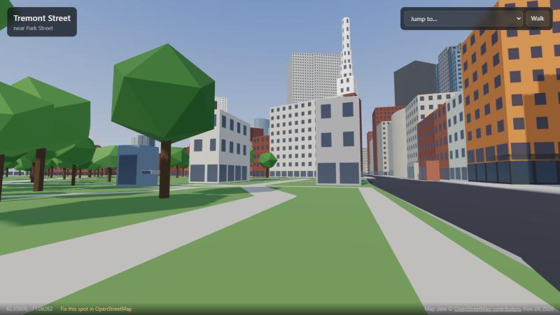
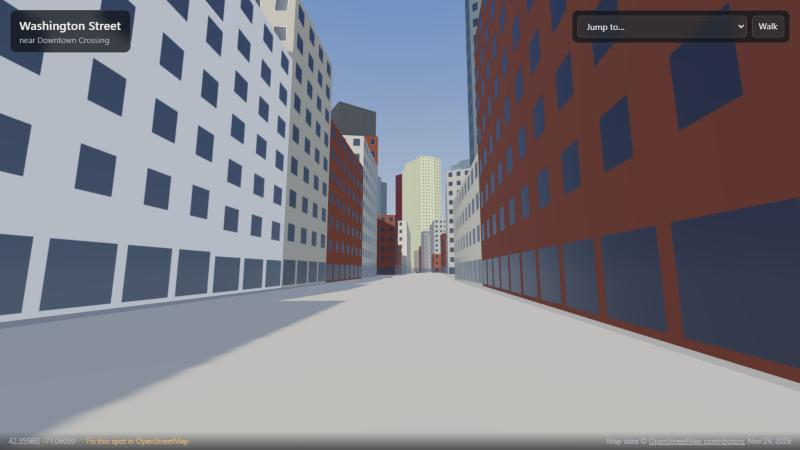
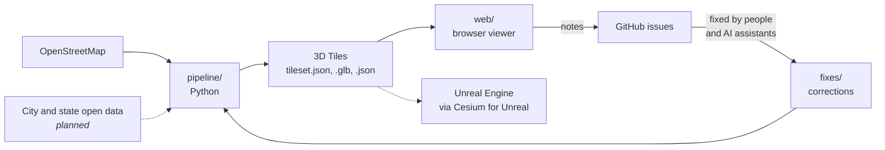

# Boston Model

An open, walkable 3D model of Boston, built from open data.

**[Walk it in your browser](https://ohinai.github.io/boston-model/)** (needs a
keyboard and mouse; about 26 MB to load).


| | |
|---|---|
|  |  |

The goal is a city that feels real to walk through, and that later carries
realistic activity: trains, cars, traffic lights, shops. The model is generated
from public data plus corrections kept in this repository, so anyone can
rebuild it, fix what is wrong and add detail.

See something wrong while walking? Press **N** and leave a note. It records
exactly where you stood and what you were looking at, and becomes a ticket
here.

## Status

Early. One pilot district is built: about 4.6 km² of downtown covering Boston
Common, the Public Garden, Beacon Hill, Downtown Crossing, Government Center,
the Financial District and the waterfront.

What works today:

- Real building footprints, streets with curbs, footpaths, parks, water and
  mapped trees, all from OpenStreetMap.
- Walking in a browser with collision against buildings and curbs, plus a fly
  mode for an overview.
- The street you are on and the nearest named place, read from a data layer
  that ships alongside the geometry.
- Notes: press `N` anywhere to report something, with your exact position
  attached. Open tickets appear in the model as markers.
- Fixes as text files in [`fixes/`](fixes), and a `boston-pipeline inspect`
  command that shows what the data holds at any spot.
- Output as standard [3D Tiles](https://www.ogc.org/standards/3dtiles/), so the
  same files are meant to load in Unreal Engine through Cesium for Unreal. That
  path is documented in [docs/UNREAL.md](docs/UNREAL.md) but has not been run yet.

What is not accurate yet:

- The ground is flat. Beacon Hill is not.
- Building heights are measured for only 17% of buildings. Another 34% are
  estimated from storey counts and 48% are a default guess by building type.
- Roofs are flat and facades are a generic window grid.
- Street widths are estimated from lane counts.
- Bridges and elevated roads are drawn at ground level, and tunnels are left out.

[docs/ROADMAP.md](docs/ROADMAP.md) lists what closes each of these gaps. Parks
and gardens come first.

## Run it

You need Python 3.11 or newer and Node.js 22 or newer.

```sh
# 1. Build the tiles (about a minute, mostly the download)
python -m venv .venv
.venv\Scripts\activate            # Windows; on macOS or Linux: source .venv/bin/activate
pip install -e "./pipeline[dev]"
boston-pipeline fetch pilot       # downloads about 11 MB of OpenStreetMap data
boston-pipeline build pilot       # writes web/public/tiles

# 2. Walk around
cd web
npm install
npm run dev                       # then open http://localhost:5173
```

Controls: `W A S D` to walk, mouse to look, `Shift` to run, `Space` to jump,
`F` to fly, `1` to `9` to jump to landmarks, `N` to leave a note. The address
bar tracks where you are standing, so a copied link drops someone else at the
same spot.

## How it works



The repository holds no 3D scene. It holds the recipe: a pipeline that turns
source data plus the corrections in `fixes/` into tiles. Clients
only read tiles. That split is what lets a browser and a game engine show the
same city, and what lets many people contribute without merging binary files.

| Folder | What is in it |
|---|---|
| [`pipeline/`](pipeline) | Python package that downloads source data and builds tiles |
| [`web/`](web) | Browser viewer (TypeScript, three.js) |
| [`fixes/`](fixes) | Corrections applied on top of source data |
| [`AGENTS.md`](AGENTS.md) | Guide for AI coding assistants fixing notes |
| [`areas.toml`](areas.toml) | The areas that can be built, and their landmarks |
| [`docs/`](docs) | Architecture, data sources, roadmap, Unreal guide |

[docs/ARCHITECTURE.md](docs/ARCHITECTURE.md) has the coordinate system, the
tile format and the reasoning behind them.

## Contributing

The simplest contribution needs no setup: walk the model, press `N` where
something looks wrong, and file the ticket. Fixing a ticket means adding a
small text file under `fixes/`, which is set up to be done with an AI coding
assistant. All fixes go through this repository. See
[CONTRIBUTING.md](CONTRIBUTING.md).

## Licence

Code is under the [MIT licence](LICENSE).

Built tiles contain OpenStreetMap data, © OpenStreetMap contributors, and are
distributed under the [Open Database License 1.0](https://opendatacommons.org/licenses/odbl/1-0/),
as are the files in `fixes/`.
Anything that displays the model must show that credit, as the viewer does.
[docs/DATA_SOURCES.md](docs/DATA_SOURCES.md) lists every source and its terms.
